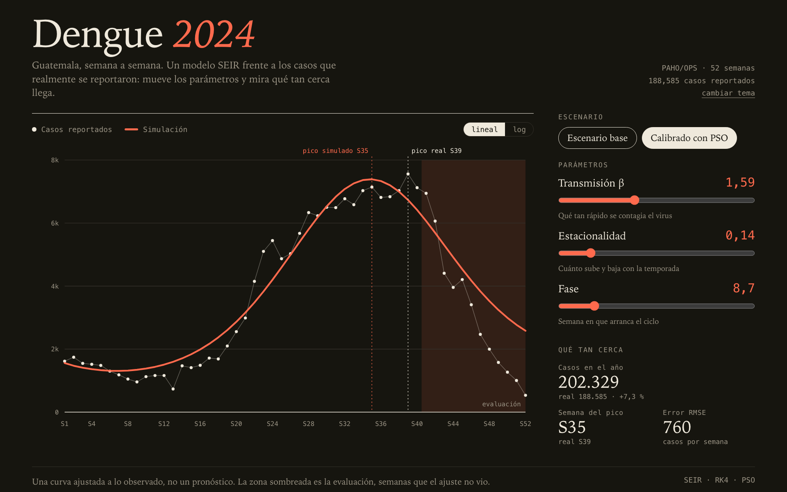

# Dengue Guatemala 2024 — Modelo SEIR y calibración PSO

Modelo SEIR semanal con transmisión estacional para la epidemia de dengue en
Guatemala durante 2024. Los parámetros de transmisión se calibran con
optimización por enjambre de partículas (PSO) y se contrastan con la serie
semanal de PAHO/OPS. El archivo MSPAS se usa para análisis por departamento,
grupo etario y sexo.



## Inicio rápido

```bash
pip install -r requirements.txt
python -m src.servidor          # interfaz web para explorar el modelo
python -m src.todo              # reproduce todo el flujo, de los datos a la comparación
```

`python -m src.todo --rapido` hace una prueba completa en menos de un minuto con
3 repeticiones, pero sobrescribe `results/`; para restaurarlo,
`git checkout results`.

## Resultados principales

| Métrica | PAHO (real) | SEIR base | SEIR calibrado (PSO) |
|---|---:|---:|---:|
| Casos acumulados 2024 | 188,585 | 6,801,065 | 202,329 |
| Semana del pico | 39 | 50 | 35 |
| Casos en la semana pico | 7,560 | 846,994 | 7,390 |
| RMSE (casos/semana) | — | 284,572 | 760 |
| Correlación con lo observado | — | −0.25 | 0.96 |

La mejora es de **ajuste del modelo a los datos**, no una reducción de contagios.
La evaluación temporal (semanas 41–52) es retrospectiva y no equivale a
validación externa ciega.

## Estructura del repositorio

```text
data/        raw/ (fuentes originales) y processed/ (datos limpios); ver data/README.md
config/      límites de búsqueda del PSO
src/         código del modelo, la calibración, los experimentos y la comparación
tests/       pruebas automáticas (pytest)
results/     salidas generadas: CSV, JSON y gráficas
docs/        texto del informe por secciones y guía de defensa
```

| Módulo | Función |
|---|---|
| `src/datos.py` | Carga, limpieza y validación de PAHO y MSPAS |
| `src/modelo_seir.py`, `src/escenarios.py` | Ecuaciones, parámetros y escenarios |
| `src/simulacion.py`, `src/main.py` | Motor de simulación y escenario base |
| `src/optimizacion.py`, `src/evaluacion_pso.py` | Calibración PSO |
| `src/estudio_pso.py`, `src/reporte_pso.py` | Estudio reproducible y figuras del PSO |
| `src/experimentos.py` | Repeticiones, sensibilidad y verificaciones |
| `src/comparacion.py`, `src/graficas.py` | Comparación con datos reales y gráficas |
| `src/metricas.py` | MAE y RMSE compartidos por todos los módulos |
| `src/servidor.py`, `ui/index.html` | Interfaz web interactiva para la presentación |
| `src/todo.py` | Ejecuta todo el flujo con un solo comando |

## Requisitos

Python 3.10 o posterior.

```bash
python -m venv .venv
source .venv/bin/activate        # Windows: .venv\Scripts\activate
pip install -r requirements.txt
```

Para reproducir las versiones directas del entorno verificado (Python 3.13.7,
Windows), usar `python -m pip install -r requirements-lock.txt`. Ese archivo no
congela dependencias transitivas y sus versiones pueden requerir un intérprete
más reciente.

## Reproducción completa

`python -m src.todo` ejecuta los pasos siguientes en este orden (30 repeticiones
por defecto; el estudio PSO y los experimentos tardan unos minutos cada uno).
Para ejecutarlos uno por uno, desde la raíz del repositorio:

```bash
python -m src.datos
python -m src.main
python -m src.estudio_pso --repeticiones 30 --procesos 3 --sobrescribir
python -m src.reporte_pso
python -m src.experimentos --repeticiones 30 --procesos 2
cp results/pso/estudio/seleccion/simulacion_mejorada.csv results/
python -m src.comparacion
pytest
```

El paso `cp` deja la trayectoria seleccionada por el estudio como escenario
mejorado que usa el comparador (en `cmd` de Windows usar `copy` con barras
invertidas; en PowerShell `cp` funciona igual).

El repositorio ya incluye las 90 corridas del estudio en
`results/pso/estudio/corridas/`. `--sobrescribir` las recalcula desde cero; para
solo verificar que la caché corresponde al código y datos actuales y regenerar
los resúmenes sin volver a optimizar, usar `--reanudar` en su lugar.

## Descripción por etapas

### 1. Datos

```bash
python -m src.datos
```

Prepara y valida la serie PAHO (52 semanas, 188,585 casos) y los datos MSPAS.
La procedencia y transformaciones están en [data/README.md](data/README.md).

### 2. Escenario base

```bash
python -m src.main
```

Genera `results/simulacion_base.csv`, `comparacion_paho.csv` y
`resumen_base.json`. El escenario base **no está calibrado**: sirve para validar
el motor de simulación, no para hacer inferencia epidemiológica.

### 3. Calibración con PSO

```bash
python -m src.optimizacion --semilla 2026
```

El PSO ajusta `beta_base`, amplitud y fase para minimizar el RMSE en las semanas
1–40; las semanas 41–52 se reservan para evaluación. Genera
`results/simulacion_mejorada.csv`, `convergencia_pso.csv`,
`metricas_calibracion_pso.csv` y `calibracion_pso.json`.

> Ejecutar `src.optimizacion` sobre la carpeta predeterminada sustituye la
> selección vigente por esa ejecución individual. Para conservarla, usar otra
> carpeta con `--salida`, por ejemplo
> `python -m src.optimizacion --semilla 2027 --salida results/pso_semilla_2027`.

#### Estudio reproducible

```bash
python -m src.estudio_pso --repeticiones 30 --procesos 3 --sobrescribir
python -m src.reporte_pso
```

Ejecuta 90 corridas (PSO principal, PSO con presupuesto reducido y búsqueda
aleatoria, 30 semillas cada una) y deja tablas, figuras y evidencia por corrida en
`results/pso/estudio/`. `--reanudar` reutiliza las corridas guardadas. Detalles del
algoritmo, opciones y archivos generados en [docs/pso_detalles.md](docs/pso_detalles.md).

### 4. Experimentación y validación

```bash
python -m src.experimentos --repeticiones 30 --procesos 2
```

Ejecuta tres condiciones con las mismas métricas: base (determinista), mejorada
(PSO, 30 semillas) y sensibilidad con período infeccioso de 7 días (PSO, mismas
30 semillas). Incluye una sensibilidad local de ±10 % y ±20 % por parámetro y 14
verificaciones internas del modelo. Tarda unos 2–3 minutos.

Resultados en `results/experimentos/`: `protocolo.json`, `corridas.csv`,
`trayectorias.csv`, `resumen_condiciones.csv`, `diferencias_pareadas.csv`,
`sensibilidad_local.csv` y `verificaciones.csv`.

### 5. Comparación con datos reales

```bash
python -m src.comparacion
```

Compara PAHO, el escenario base y el mejorado (`results/simulacion_mejorada.csv`)
y genera en `results/`:

- `metricas_comparacion.csv`: MAE, RMSE, MAPE, diferencias totales, semana del pico y correlación.
- `comparacion_semanal.csv`: diferencias absolutas y porcentuales semana a semana.
- `grafica_curva_epidemica.png`, `grafica_comparacion_escenarios.png` y
  `grafica_sensibilidad_local.png`.

Para comparar contra otra carpeta de resultados:

```bash
python -c "from src.comparacion import main; main('results/pso/estudio/seleccion')"
```

## Interfaz web

```bash
python -m src.servidor
```

Abre `http://127.0.0.1:8000` con la curva simulada frente a los casos de PAHO,
deslizadores para `beta_base`, amplitud y fase, y los escenarios base y calibrado
(requiere `results/pso/estudio/seleccion/calibracion_pso.json` para el segundo).
Usa `--puerto` para cambiar el puerto y `--sin-navegador` para no abrirlo solo.
No necesita internet ni dependencias adicionales.

## Pruebas y estilo

```bash
pytest
ruff check src tests      # lint (configuración en ruff.toml)
ruff format src tests     # formato, 100 columnas
```

## Documentación del informe

- [Secciones 2 y 4: técnica y mejora](docs/informe_persona_3.md)
- [Sección 5: experimentación y validación](docs/informe_persona_4.md)
- [Secciones 6 y 7: comparación, resultados y conclusiones](docs/informe_persona_5.md)
- [Guía de defensa y demostración](docs/guia_defensa_pso.md)
- [Detalles del algoritmo PSO y del estudio](docs/pso_detalles.md)
- [Procedencia de los datos](data/README.md)

## Limitaciones

- Modelo determinista de una sola población, sin vector, serotipos ni
  heterogeneidad por departamento.
- Un único año de calibración y evaluación.
- Simulación determinista: `modo_estocastico` no está implementado. La aleatoriedad del
  proyecto proviene solo del PSO, controlada con semillas registradas.
- La calibración es muy sensible a `beta_base` y a `gamma`, que están
  correlacionados; sus valores ajustados no son estimaciones biológicas
  independientes.
- El modelo no reproduce la caída final del año (semanas 41–52) y adelanta el
  pico unas cuatro semanas.
