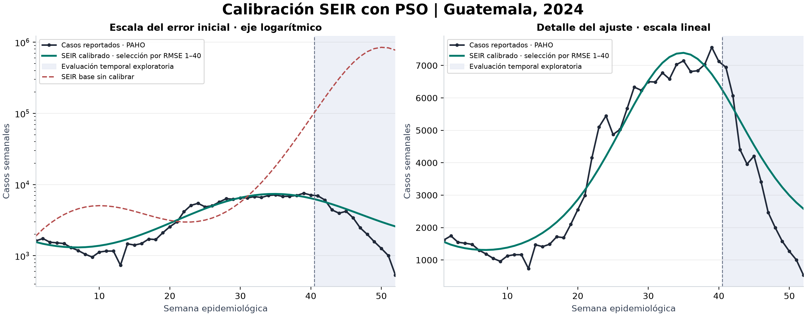
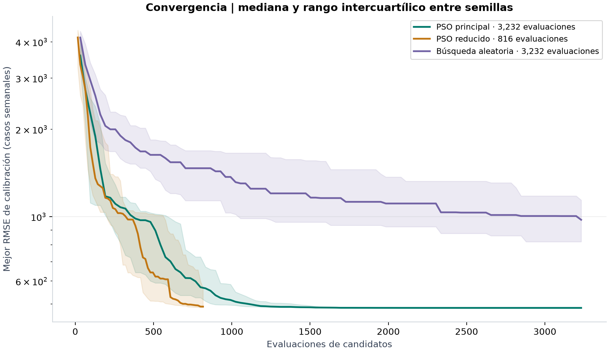
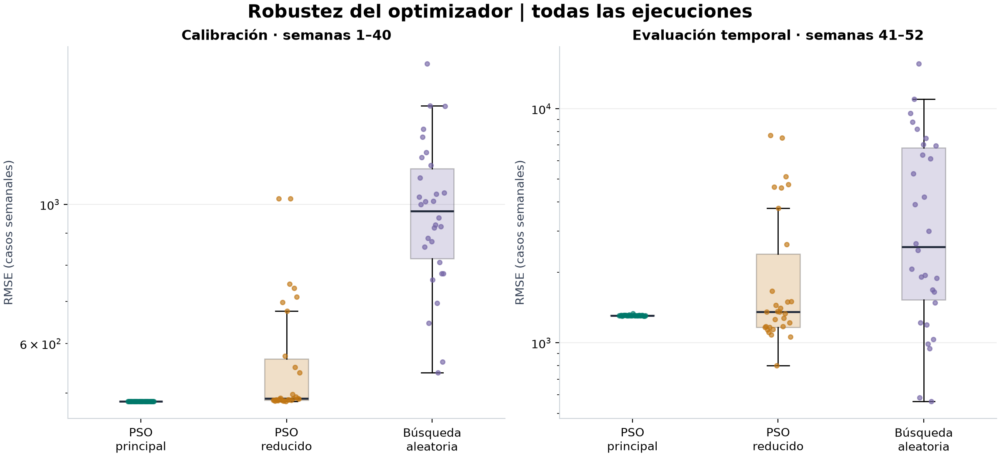
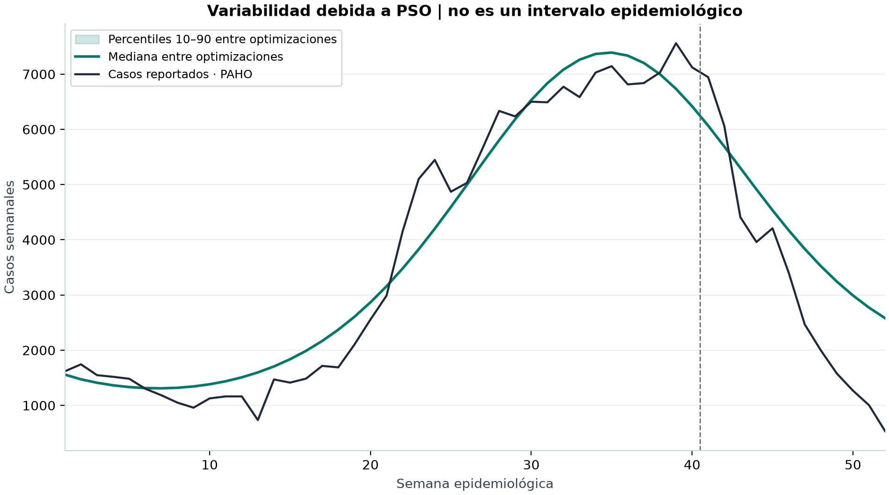

# Resultados de la calibración PSO

Estudio: 30 semillas por condición. Selección solo por RMSE de calibración.

| Período | RMSE base | RMSE calibrado | Reducción del RMSE |
|---|---:|---:|---:|
| calibracion | 17,442.09 | 485.13 | 97.22 % |
| evaluacion | 591,528.08 | 1,309.77 | 99.78 % |

Unidad: casos semanales. Una reducción de error no es reducción de contagios.

## Solución seleccionada

Semilla: `12363927176062748131`.

- beta_base: 1.589089117
- amplitud: 0.1434442141
- fase: 8.731765368

Total simulado: 202,328.96; referencia: 188,585 casos.
Pico simulado: semana 35; referencia: semana 39.

## Comparación entre métodos

PSO tuvo menor RMSE de calibración que la búsqueda aleatoria en 30 de 30 pares.
PSO principal superó al presupuesto reducido en 30 de 30 pares.

La comparación usa estadísticas descriptivas y diferencias pareadas; no se declara significancia estadística.
La evaluación temporal es retrospectiva y exploratoria. No equivale a validación externa ciega.
La dispersión entre semillas caracteriza la búsqueda, no la incertidumbre de los casos reales.

Consulte `estadisticas.csv` para media, desviación estándar muestral, mediana, cuartiles y extremos.

## Figuras

La curva calibrada reproduce la escala del brote y su descenso, aunque el pico aparece antes que el observado. La separación sombreada identifica las semanas que no entran al objetivo. El panel logarítmico conserva visible la gran desviación del escenario base.

Con igual número de evaluaciones, la mediana de PSO termina con menor error de calibración que la búsqueda aleatoria. La banda representa cuartiles entre semillas. El PSO reducido termina antes porque tiene un presupuesto distinto; su curva no debe extrapolarse al presupuesto completo.

Se muestran todas las ejecuciones como puntos, además de las cajas. El PSO principal concentra sus errores cerca del mismo valor; el presupuesto reducido y la búsqueda aleatoria muestran mayor dispersión. La comparación temporal no participa en la elección del ganador.

La banda de percentiles es muy estrecha porque las optimizaciones principales encuentran curvas similares. Eso no explica toda la diferencia con PAHO: la estabilidad del optimizador no elimina el error estructural del modelo.

La tabla `comparacion_referencia_real.csv` contrasta total anual, semana y magnitud del pico con las mismas unidades para referencia, modelo base y calibrado.
